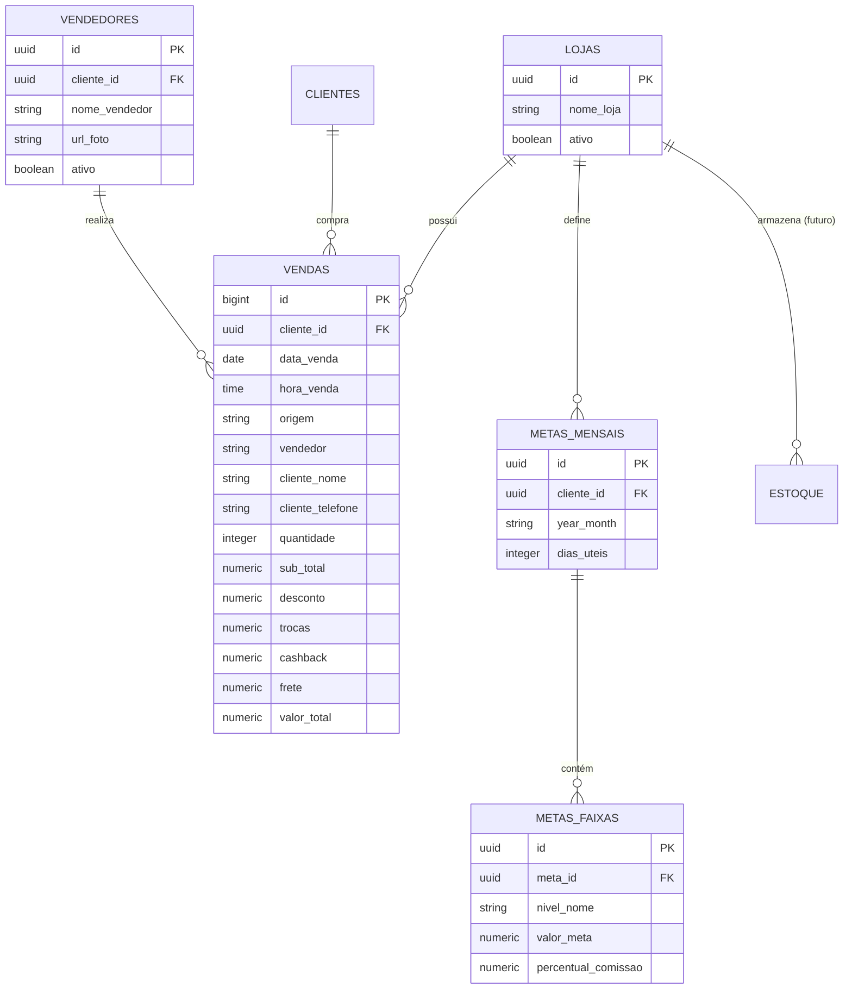

# Organização e Modelagem de Dados | BlushFit (Origem PHIBO)

Este documento define a **arquitetura de dados, dicionário de tabelas, modelagem dimensional e regras de agregação** para a construção do novo sistema exclusivo da **BlushFit**, utilizando como fonte primária os dados extraídos do ERP **PHIBO**.

---

## 1. Visão Geral da Arquitetura de Dados

O modelo de dados da BlushFit opera no padrão **Star Schema (Fatos e Dimensões)** simplificado para alta performance em painéis analíticos:



---

## 2. Dicionário de Dados das Tabelas PHIBO (Supabase)

### 2.1. Tabela: `phibo_clientes_config` (Dimensão Loja / Unidade)
Armazena as configurações e credenciais de acesso às unidades da BlushFit cadastradas no PHIBO.

| Coluna | Tipo de Dado | Nulo? | Chave | Descrição / Regra de Negócio |
|---|---|---|---|---|
| `id` | `uuid` | Não | **PK** | Identificador único universal da loja/unidade. *(Ex: BlushFit = `e4190b32-62e4-4ae8-a8f1-6b8b8fcac49e`)* |
| `nome_loja` | `varchar` | Não | | Nome fantasia da unidade (Ex: "BlushFit"). |
| `email_login_phibo` | `varchar` | Não | | E-mail utilizado pelo script de automação para autenticar no PHIBO. |
| `senha_login_phibo` | `varchar` | Não | | Senha criptografada/armazenada para conexão ao PHIBO. |
| `ativo` | `boolean` | Sim | | Flag de atividade (`true` = loja em operação, `false` = desativada). Padrão: `true`. |
| `created_at` | `timestamptz` | Sim | | Data e hora de cadastro da loja no banco de dados. |
| `updated_at` | `timestamptz` | Sim | | Data e hora da última modificação dos dados da loja. |

---

### 2.2. Tabela: `phibo_vendas` (Tabela Fato de Vendas / Pedidos)
Armazena cada atendimento, cupom ou pedido faturado no PHIBO.

| Coluna | Tipo de Dado | Nulo? | Chave | Descrição / Regra de Negócio |
|---|---|---|---|---|
| `id` | `bigint` | Não | **PK** | Identificador único sequencial do pedido/venda. |
| `cliente_id` | `uuid` | Sim | **FK** | Referência à loja proprietária da venda (`phibo_clientes_config.id`). |
| `origem` | `varchar` | Sim | | Canal de venda de origem (Ex: `Loja Física`, `WhatsApp`, `E-commerce`, `Instagram`). |
| `data_venda` | `date` | Não | | Data oficial em que a venda foi faturada (`AAAA-MM-DD`). |
| `hora_venda` | `time` | Não | | Horário exato da emissão do cupom (`HH:MM:SS`). |
| `cliente_nome` | `varchar` | Sim | | Nome da cliente compradora registrado no PHIBO. |
| `cliente_telefone`| `varchar` | Sim | | Número de telefone/WhatsApp da cliente (ótimo para CRM e pós-venda). |
| `cliente_completo`| `text` | Sim | | Detalhes adicionais, observações ou endereço completo em formato texto/JSON. |
| `vendedor` | `varchar` | Sim | | Nome da vendedora responsável pelo atendimento (Ex: `Juliana`, `PLISSIA`, `Site`). |
| `quantidade` | `integer` | Sim | | Total de **peças/itens** contidos nessa venda (Base para o cálculo do **P.A**). |
| `sub_total` | `numeric` | Sim | | Valor bruto da soma dos produtos antes de abatimentos promocionais. |
| `desconto` | `numeric` | Sim | | Valor total em R$ de descontos concedidos na venda. |
| `trocas` | `numeric` | Sim | | Valor abatido referente a devoluções/trocas de mercadoria. |
| `cashback` | `numeric` | Sim | | Saldo de cashback resgatado ou aplicado como crédito na compra. |
| `frete` | `numeric` | Sim | | Taxa de entrega/frete cobrada do cliente. |
| `valor_total` | `numeric` | Sim | | **Faturamento Líquido Final da Venda** recebido no caixa. |
| `created_at` | `timestamptz` | Sim | | Timestamp de sincronização do registro no Supabase. |

---

## 3. Mapeamento de Fórmulas e KPIs Comerciais

Abaixo estão as fórmulas SQL para alimentar os cards, gráficos e relatórios do painel da BlushFit com base direta na `phibo_vendas`:

### 3.1. Faturamento Total Líquido
Valor real faturado pela loja no período:
```sql
SELECT COALESCE(SUM(valor_total), 0) AS faturamento_total
FROM phibo_vendas
WHERE cliente_id = :cliente_id
  AND data_venda BETWEEN :data_inicio AND :data_fim;
```

### 3.2. Quantidade de Vendas (Atendimentos)
Volume de transações/cupons fechados:
```sql
SELECT COUNT(id) AS total_atendimentos
FROM phibo_vendas
WHERE cliente_id = :cliente_id
  AND data_venda BETWEEN :data_inicio AND :data_fim;
```

### 3.3. Ticket Médio por Venda
Gasto médio de cada cliente por visita:
```sql
SELECT 
  CASE 
    WHEN COUNT(id) > 0 THEN ROUND(SUM(valor_total) / COUNT(id), 2)
    ELSE 0 
  END AS ticket_medio
FROM phibo_vendas
WHERE cliente_id = :cliente_id
  AND data_venda BETWEEN :data_inicio AND :data_fim;
```

### 3.4. P.A (Peças por Atendimento)
Média de itens levados em cada compra (essencial para medir poder de persuasão e técnicas de venda adicional):
```sql
SELECT 
  CASE 
    WHEN COUNT(id) > 0 THEN ROUND(SUM(quantidade)::numeric / COUNT(id), 2)
    ELSE 0 
  END AS pa_loja
FROM phibo_vendas
WHERE cliente_id = :cliente_id
  AND data_venda BETWEEN :data_inicio AND :data_fim;
```

### 3.5. Ranking e Desempenho por Vendedora
Consolidação completa para montar o pódio e a tabela de comissões:
```sql
SELECT 
  vendedor,
  COUNT(id) AS total_atendimentos,
  SUM(quantidade) AS total_pecas,
  SUM(valor_total) AS total_faturado,
  ROUND(SUM(valor_total) / NULLIF(COUNT(id), 0), 2) AS ticket_medio,
  ROUND(SUM(quantidade)::numeric / NULLIF(COUNT(id), 0), 2) AS pa_individual
FROM phibo_vendas
WHERE cliente_id = :cliente_id
  AND data_venda BETWEEN :data_inicio AND :data_fim
GROUP BY vendedor
ORDER BY total_faturado DESC;
```

### 3.6. Linha do Tempo Diária (Timeline)
Evolução do faturamento dia a dia para alimentar o gráfico de área/linhas:
```sql
SELECT 
  data_venda,
  COUNT(id) AS qtd_vendas,
  SUM(valor_total) AS faturamento_dia
FROM phibo_vendas
WHERE cliente_id = :cliente_id
  AND data_venda BETWEEN :data_inicio AND :data_fim
GROUP BY data_venda
ORDER BY data_venda ASC;
```

---

## 4. Tabelas Complementares Padronizadas para o Sistema (Prefixo Exclusivo `phibo_`)

Para construir a aplicação de forma limpa, isolada de outros projetos no mesmo banco de dados e pronta para multi-tenancy:

### 4.1. `phibo_perfis` (Usuários do Sistema)
Substitui a antiga `multi_profiles`, contendo apenas os campos essenciais:
* `id` (`uuid`, PK, vinculado a `auth.users.id`)
* `cliente_id` (`uuid`, FK vinculado a `phibo_clientes_config.id`)
* `full_name` (`text`) — Nome completo do usuário
* `email` (`text`) — E-mail de login
* `role` (`text`) — Papel (`super_admin`, `admin`, `manager`, `seller`)
* `nome_vendedor` (`text`, nullable) — Se for vendedora, vincula ao nome na `phibo_vendas`
* `ativo` (`boolean`, default: `true`)

### 4.2. `phibo_vendedores_config` (Cadastro Visual de Vendedoras)
* `id` (`uuid`, PK)
* `cliente_id` (`uuid`, FK)
* `nome_vendedor` (`text`) — Grafia oficial
* `url_foto` (`text`) — Foto de perfil para pódio e avatares
* `peso_meta` (`numeric`, default: 1.0) — Fator de ponderação da meta
* `ativo` (`boolean`) — Flag para considerar ou não no rateio de metas

### 4.3. `phibo_metas_mensais` (Metas da Loja)
* `id` (`uuid`, PK)
* `cliente_id` (`uuid`, FK)
* `year_month` (`varchar(7)`) — Ex: `'2026-10'`
* `dias_uteis` (`integer`) — Quantidade de dias úteis no mês
* `meta_minima` (`numeric`) — Valor em R$
* `meta_top1` (`numeric`) — Valor em R$
* `meta_top2` (`numeric`) — Valor em R$
* `meta_master` (`numeric`) — Valor em R$
* `perc_minima` (`numeric`) — Percentual de comissão (Ex: 1.0%)
* `perc_top1` (`numeric`) — Percentual de comissão (Ex: 1.5%)
* `perc_top2` (`numeric`) — Percentual de comissão (Ex: 2.0%)
* `perc_master` (`numeric`) — Percentual de comissão (Ex: 2.5%)
* `distribution_mode` (`varchar(20)`) — `'uniform'`, `'week'`, `'day'`

### 4.4. `phibo_campanhas` (Ações Promocionais Sazonais)
* `id` (`uuid`, PK)
* `cliente_id` (`uuid`, FK)
* `nome` (`text`) — Ex: "Lançamento Coleção Outono/Inverno"
* `data_inicio` (`date`)
* `data_fim` (`date`)
* `meta_valor` (`numeric`)

---

## 5. Estrutura Futura para Ingestão de Estoque do PHIBO

Quando você for extrair os dados de inventário do PHIBO, a tabela de estoque ideal deve seguir este formato simplificado:

```sql
CREATE TABLE public.phibo_estoque (
  id UUID PRIMARY KEY DEFAULT gen_random_uuid(),
  cliente_id UUID REFERENCES public.phibo_clientes_config(id),
  codigo_produto VARCHAR(50),
  descricao VARCHAR(255) NOT NULL,
  categoria VARCHAR(100),       -- Ex: 'Legging', 'Top', 'Shorts', 'Acessórios'
  tamanho VARCHAR(20),          -- Ex: 'P', 'M', 'G', 'GG'
  cor VARCHAR(50),
  saldo_estoque INTEGER NOT NULL DEFAULT 0,
  custo_unitario NUMERIC(10,2) DEFAULT 0,
  preco_venda NUMERIC(10,2) NOT NULL DEFAULT 0,
  updated_at TIMESTAMPTZ DEFAULT now()
);
```

Com essa estrutura, a **Curva ABC** e os **Dias de Cobertura de Estoque** calculados no documento [RULES.md](file:///c:/Users/Usuario/Downloads/BlushFit/RULES.md) funcionarão de forma instantânea.

---

## 6. Índices Recomendados para Alta Performance

Para garantir que as consultas retornem em menos de 100ms mesmo após milhares de pedidos:

```sql
-- Índice composto para consultas por período e loja (o filtro mais comum do dashboard)
CREATE INDEX idx_phibo_vendas_cliente_data ON public.phibo_vendas (cliente_id, data_venda);

-- Índice para agrupamentos por vendedora
CREATE INDEX idx_phibo_vendas_vendedor ON public.phibo_vendas (cliente_id, vendedor);

-- Índice para filtro por origem/canal de venda
CREATE INDEX idx_phibo_vendas_origem ON public.phibo_vendas (cliente_id, origem);
```
