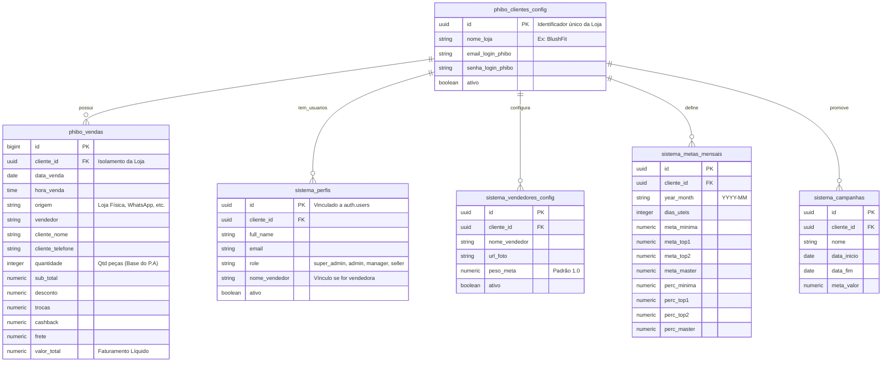

# PRD - Product Requirements Document | Plataforma SaaS Comercial PHIBO (Cliente Piloto: BlushFit)

**Documento de Requisitos do Produto (PRD)**  
**Projeto:** Plataforma Multi-Tenant de BI, Metas e Comissões Comerciais para ERP PHIBO  
**Versão:** 2.0 (Revisado com foco SaaS Multi-Loja e despriorização de Estoque/IA)  
**Data:** 2026-10-20  
**Autor:** Antigravity / Time de Engenharia e Negócios  
**Status:** Aprovado para Implementação  

---

## 1. Visão Geral do Produto e Posicionamento SaaS

### 1.1. Propósito e Modelo Multi-Tenant
A plataforma é um **software analítico e de gestão comercial (SaaS Multi-Tenant)** projetado especificamente para lojas físicas e e-commerces que utilizam o ERP **PHIBO**.

O sistema é construído de forma **genérica e modular**, permitindo que:
1. **A BlushFit seja a loja de estreia (Cliente Piloto)**.
2. **Novas lojas/clientes que utilizam o PHIBO** possam ser cadastrados a qualquer momento sem necessidade de alterar o código do sistema — bastando criar a loja em `phibo_clientes_config`, vincular os usuários e começar a sincronizar as vendas.
3. **Isolamento e Governança Absoluta:** Usuários de uma loja jamais visualizam dados de outra loja (isolamento rígido via Row Level Security - RLS). Apenas o `super_admin` tem visão multi-loja.

```
                      [ Plataforma SaaS PHIBO BI ]
                                    │
        ┌───────────────────────────┼───────────────────────────┐
        ▼                           ▼                           ▼
  [ Loja 1: BlushFit ]       [ Loja 2: Cliente B ]       [ Loja 3: Cliente C ]
  - Usuários BlushFit        - Usuários Cliente B        - Usuários Cliente C
  - Metas BlushFit           - Metas Cliente B           - Metas Cliente C
  - RLS: cliente_id = 1      - RLS: cliente_id = 2       - RLS: cliente_id = 3
```

### 1.2. Decisões de Escopo e Priorização (MVP)
* 🔴 **Agente de IA e n8n:** **Mapeado para o Backlog Futuro**. Foco imediato 100% no software web analítico e operacional validado.
* 🟡 **Módulo de Estoque / Curva ABC:** **Aguardando dados do PHIBO**. O modelo de dados está projetado, mas a tela e as lógicas de estoque ficarão ocultas/inativas até que o ERP disponibilize a sincronização de saldo físico.
* 🟢 **Múltiplas Sessões Simultâneas Permitidas:** O sistema deve permitir que mais de uma pessoa acerte e use a plataforma ao mesmo tempo (inclusive com a mesma conta ou com logins diferentes da mesma loja) **sem forçar logout ou invalidar sessões ativas**.

---

## 2. Personas e Matriz de Acesso e Governança (RBAC)

### 2.1. Níveis de Acesso
1. **`super_admin` (Diretoria / Administrador Global do SaaS):**
   - Cria e gerencia qualquer loja no sistema.
   - Pode alternar livremente entre lojas da rede ou ver o consolidado geral.
   - Cria usuários e define perfis.
2. **`admin` (Proprietário ou Diretor da Loja):**
   - Acesso irrestrito a **todas as funcionalidades da sua loja vinculada** (e somente da sua loja).
   - Gerencia metas mensais, percentuais de comissão e parâmetros de vendedores da sua unidade.
3. **`manager` (Gerente da Loja):**
   - Acompanha faturamento, ticket médio, P.A, ranking e comissões da sua unidade.
   - Não altera parâmetros estruturais de metas ou permissões de usuários.
4. **`seller` (Vendedora):**
   - Acesso exclusivo ao seu próprio painel individual (`/vendedor/:name`).
   - Visualiza seu faturamento, comissão estimada, seu P.A e distância para a próxima meta.

### 2.2. Matriz de Governança Multi-Loja
| Funcionalidade / Tela | `super_admin` | `admin` (Loja A) | `manager` (Loja A) | `seller` (Loja A) |
|---|:---:|:---:|:---:|:---:|
| Cadastrar nova loja no SaaS | ✅ | ❌ | ❌ | ❌ |
| Acessar dados da Loja A | ✅ | ✅ | ✅ | ✅ (só os seus) |
| Acessar dados da Loja B | ✅ | ❌ | ❌ | ❌ |
| Dashboard Comercial Geral | ✅ | ✅ (sua loja) | ✅ (sua loja) | ❌ |
| Painel Pessoal da Vendedora | ✅ | ✅ | ✅ | ✅ (somente o seu) |
| Configurar Metas e Comissões | ✅ | ✅ (sua loja) | ❌ | ❌ |
| Normalizar Nomes de Vendedoras | ✅ | ✅ (sua loja) | ❌ | ❌ |

---

## 3. Requisitos Funcionais (FR)

### FR-01: Autenticação, Sessões Simultâneas e Multi-Tenant
- **FR-01.1:** Login via Supabase Auth (e-mail e senha).
- **FR-01.2 (Sessões Simultâneas):** O sistema **não deve deslogar** outros usuários ou outros navegadores abertos quando um novo acesso for realizado. Múltiplos dispositivos e pessoas podem utilizar a plataforma simultaneamente sem interrupção de sessão.
- **FR-01.3:** Contexto de Loja: Ao entrar, o usuário é direcionado para a sua loja cadastrada. Se o usuário possuir mais de uma loja associada (caso de diretores/super_admin), ele tem um seletor de lojas acessível.
- **FR-01.4:** Guardas de Rota: Telas administrativas (`/admin/*`) bloqueadas para perfis sem permissão.
- **FR-01.5:** Branding Dinâmico: A interface exibe o nome e logo da loja selecionada (ex: "BlushFit").

### FR-02: Dashboard Comercial Principal (`/dashboard/:cliente_id`)
- **FR-02.1:** Cards de KPIs principais do período selecionado:
  - **Faturamento Total Líquido (R$):** Soma de `valor_total` das vendas da loja.
  - **Total de Atendimentos:** Contagem de vendas/cupons únicos faturados.
  - **Ticket Médio (R$):** $\frac{\text{Faturamento}}{\text{Atendimentos}}$.
  - **Peças por Atendimento (P.A):** $\frac{\text{Total de Itens}}{\text{Atendimentos}}$.
  - **Comissões a Pagar (R$):** Total consolidado de comissão calculada pela régua de metas.
- **FR-02.2:** Filtros Operacionais:
  - Seletor de Mês (com opção de navegação rápida).
  - Período personalizado com intervalo de datas (`dataInicio` a `dataFim`).
  - Filtro por Vendedora individual.
  - Filtro por Canal de Venda / Origem (`Loja Física`, `WhatsApp`, `E-commerce`, `Instagram`).
- **FR-02.3:** Linha do Tempo diária com curva de faturamento realizado vs. ritmo ideal para bater a meta.
- **FR-02.4:** Ranking e Pódio de Vendedoras (ouro, prata e bronze, com foto, vendas, atendimentos e P.A).
- **FR-02.5:** Exportação de relatórios em Excel (`.xlsx`) e PDF formatados com padrão de moeda brasileiro (`R$`).

### FR-03: Motor de Metas e Comissões Dinâmicas (Meritocracia)
- **FR-03.1:** Cada loja define suas faixas mensais:
  - **Meta Mínima** (Ex: 1,0% de comissão)
  - **Meta Top 1** (Ex: 1,5% de comissão)
  - **Meta Top 2** (Ex: 2,0% de comissão)
  - **Meta Master** (Ex: 2,5% de comissão)
- **FR-03.2:** Rateio automático da meta global da loja entre as vendedoras ativas (com suporte a pesos/fatores individuais se houver vendedoras em meio período ou treinamento).
- **FR-03.3:** Distribuição da meta ao longo do mês:
  - Uniforme por dias úteis cadastrados.
  - Semanal (pesos % customizáveis por semana).
- **FR-03.4:** Apuração instantânea: À medida que uma vendedora alcança um novo patamar, sua comissão sobre todo o período (ou incremental) sobe para a alíquota da faixa conquistada.
- **FR-03.5:** Tabela detalhada de comissões para o financeiro e conferência da equipe.

### FR-04: Módulo de P.A (Peças por Atendimento)
- **FR-04.1:** Apuração do P.A individual de cada vendedora vs. o P.A médio da loja.
- **FR-04.2:** Diferencial ($\Delta_{\text{P.A}}$):
  - $\Delta > 0 \implies$ Destaque Verde (puxa o ticket da loja para cima).
  - $\Delta < 0 \implies$ Destaque Âmbar/Vermelho (ponto de atenção e oportunidade de treinamento).

### FR-05: Perfil 360º da Vendedora (`/vendedor/:name`)
- **FR-05.1:** Painel individual simplificado e responsivo para visualização no celular.
- **FR-05.2:** Total vendido no mês, comissão acumulada e valor que falta para o próximo nível de meta.
- **FR-05.3:** Linha de tendência diária individual vs. ritmo de meta individual.
- **FR-05.4:** Projeção linear de faturamento para o último dia do mês baseada na média diária atual.
- **FR-05.5:** Performance por dia da semana (identificando quais dias a vendedora mais vende).

### FR-06: Campanhas Promocionais Sazonais (`/campanhas`)
- **FR-06.1:** Cadastro de ações (Ex: Lançamento de Coleção, Bazar, Dia das Mães, Black Friday).
- **FR-06.2:** Acompanhamento automático de atingimento das vendas dentro do período da campanha.

### FR-07: Gestão Comercial da Loja (`/metas`) - Vendedoras & Metas
- **FR-07.1: Gestão de Metas Mensais:** Configuração dos 4 patamares de meritocracia (Mínima, Top 1, Top 2, Master), percentuais de comissão progressiva e dias úteis. Acessível por Gerente e Super Admin.
- **FR-07.2: Gestão de Vendedoras & Fotos:** Padronização de nomes cadastrados no PHIBO + upload direto de imagens (PNG, JPG, prints da tela) e ativação no rateio. Acessível por Gerente e Super Admin.

### FR-08: Painel de Governança Multi-Tenant (`/governanca`)
- **FR-08.1: Cadastro e Acoplamento de Lojas PHIBO:** Formulário para inclusão de novos clientes com geração de UUID (`cliente_id`) e parâmetros de sincronização do ERP PHIBO. Restrito exclusivamente ao `super_admin`.
- **FR-08.2: Monitoramento de Tenants:** Visualização de todas as unidades conectadas com garantia de isolamento via RLS.

---

## 4. Requisitos Não Funcionais (NFR)

- **NFR-01 (Multi-Sessão Sem Desconexão):** A autenticação via Supabase Auth deve manter tokens de sessão locais independentes por navegador/dispositivo. Uma nova conexão não deve revogar tokens de outros navegadores ativos.
- **NFR-02 (Isolamento RLS Multi-Tenant):** Toda e qualquer consulta às tabelas (`phibo_vendas`, `blushfit_metas_mensais`, etc.) **deve** incluir a cláusula `cliente_id` validada via Row Level Security (RLS) no PostgreSQL.
- **NFR-03 (Performance Analítica):** Consultas ao dashboard devem ser consolidadas via RPC/Stored Procedure no PostgreSQL retornando JSON único em menos de **100ms**.
- **NFR-04 (Fuso Horário Padrão):** Todas as datas e agrupamentos diários devem obedecer estritamente ao fuso `America/Sao_Paulo`.
- **NFR-05 (Responsividade Mobile):** Vendedoras e gestores no salão de loja devem conseguir visualizar os números perfeitamente pelo smartphone.
- **NFR-06 (Padronização PHIBO):** O layout de dados e as colunas de ingestão devem ser 100% idênticos para a BlushFit e para qualquer outro futuro cliente que utilize o ERP PHIBO.

---

## 5. Arquitetura de Dados Padronizada para ERP PHIBO



---

## 6. Plano de Implementação (Roadmap Faseado do MVP)

### 🔹 Fase 1: Fundação Multi-Tenant & Setup Inicial
- [ ] Criação do script de banco de dados Supabase com suporte Multi-Tenant (tabelas `phibo_*` e `sistema_*`).
- [ ] Criação das políticas de RLS e índices de alta performance (`idx_phibo_vendas_cliente_data`).
- [ ] Configuração do Supabase Auth garantindo **múltiplas sessões simultâneas** sem desconexão.
- [ ] Cadastro da **BlushFit** como Loja 1 em `phibo_clientes_config`.
- [ ] Criação da RPC PostgreSQL de alta performance (`phibo_get_dashboard_data`).
- [ ] Inicialização do projeto frontend (React 18 + Vite + TypeScript + Tailwind CSS + shadcn/ui).

### 🔹 Fase 2: Dashboard Comercial Principal & KPIs de Vendas
- [ ] Layout base responsivo (Sidebar retrátil, Header com seletor/identificação da loja e perfil).
- [ ] Cards de KPIs (Faturamento Líquido, Atendimentos, Ticket Médio, P.A, Comissões).
- [ ] Filtros temporais por Mês, Intervalo de Datas, Vendedora e Canal de Venda.
- [ ] Gráfico de Linha do Tempo diária com comparação de ritmo.
- [ ] Ranking de Vendedoras com Pódio visual destacado.

### 🔹 Fase 3: Motor de Metas e Comissões Dinâmicas
- [ ] Lógica de rateio e faixas progressivas (Mínima, Top 1, Top 2 e Master).
- [ ] Tabela analítica de comissões por vendedora.
- [ ] Tabela e cálculo de Peças por Atendimento (P.A) com comparativo vs. média da loja.

### 🔹 Fase 4: Visão da Vendedora & Campanhas
- [ ] Tela individual `/vendedor/:name` adaptada para celular.
- [ ] Projeção de vendas até o fim do mês e gráfico por dia da semana.
- [ ] Tela de Acompanhamento de Campanhas Promocionais (`/campanhas`).

### 🔹 Fase 5: Governança Administrativa & Multi-Loja
- [ ] Tela `/admin/lojas`: Cadastro e gestão de novas lojas PHIBO.
- [ ] Tela `/admin/metas`: Parametrização das metas mensais e faixas de comissão da loja.
- [ ] Tela `/admin/vendedores`: Normalização de nomes do PHIBO e fotos.
- [ ] Tela `/admin/usuarios`: Gestão de acessos com papéis RBAC.

---

## 7. Backlog Futuro (Fases Posteriores ao MVP)

- [ ] **Módulo de Gestão de Estoque e Curva ABC:** Implementar assim que o ERP PHIBO disponibilizar a extração de inventário e saldo físico.
- [ ] **Automação IA / n8n via WhatsApp:** Desenvolver briefings e assistente de IA comercial após a validação e estabilização completa do BI web.
